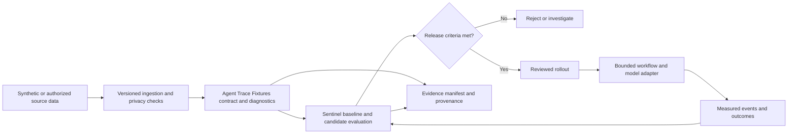

# Agent Trace Fixtures: AI reliability and longevity blueprint

Prepared 8 November 2026. Research cutoff: 8 November 2026. Status: strategic plan, with the first milestone implementation and its limits documented in [verified results](MILESTONE-1-RESULTS.md). Later phases remain proposals; no production results are claimed.

**Decision:** make Agent Trace Fixtures the evidence foundation for a reusable, trace-to-evaluation workflow. Its strongest category is **AI Reliability and Lifecycle Engineering**, specifically developer tooling and reproducible testing. Cross-reference Applied ML, Data Engineering, Infrastructure, and Automation; give each capability one implementation owner.

“Highest performance” means the best measured business outcome within correctness, safety, latency, cost, privacy, and maintenance constraints. There is no universally best model, language, or architecture. Research-level rigor comes from reproducible methods and independent scrutiny; a roadmap does not establish postdoctoral credentials or proficiency.

## 1. Fit with the existing projects

The original planning workspace was empty. Implementation now uses a full Git clone. The version difference is reconciled in [the baseline inventory](BASELINES.md): main contains the original checker, while the later pilot and verifier fix are unmerged proposals. This milestone builds on the verifier-fix branch and preserves the historical comparison baseline and archived results.

| Owner | Strongest responsibility | Connection to this plan |
|---|---|---|
| [Agent Trace Fixtures](https://github.com/Shawdaimarie/agent-trace-fixtures) | Synthetic evidence, importer contracts, deterministic failure cases | Own the corpus, diagnostic expectations, compatibility fixtures and reproducibility protocol |
| [Sentinel](https://github.com/Shawdaimarie/sentinel) | Candidate-versus-baseline evaluation and governed execution | Consume normalized evidence; own release-gate decisions |
| Aegis within Sentinel | Authorization and scoped tool access | Own allow/deny enforcement; consume tests without duplicating policy ownership |
| [EDS Assurance](https://github.com/Shawdaimarie/eds-assurance) | Source provenance, evidence contracts and report integrity | Reference evidence digests and verified reports; exact quotation is not proof of factual entailment |
| [Northstar serving platform](https://github.com/Shawdaimarie/ai-model-serving-and-workflow-platform) | Model runtime adapters and durable workflows | Supply measured execution events and model revisions; it is currently documented as a single-process reference |
| [CS–AI Path](https://github.com/Shawdaimarie/cs-ai-path) | Foundational learning and research reproduction | Store learning checkpoints; completed artifacts, rather than reading lists, demonstrate progress |

The ownership split is a recommendation, informed by the [public profile](https://github.com/Shawdaimarie/Shawdaimarie/blob/main/README.md) and repository documentation. It is not a claim that these projects already interoperate. The first integration needs only Agent Trace Fixtures and one Sentinel adapter. Avoid making all projects mandatory dependencies.

## 2. Recent university evidence and resulting decisions

This is a selected evidence register, not an exhaustive literature review or university ranking. Dates refer to the paper or institutional report specified. The implementation decisions are our synthesis; the universities have not endorsed this project. Research results require reproduction on our workload before becoming project performance claims.

| Institution | Verified research or institutional evidence | What it supports | Decision and limitation |
|---|---|---|---|
| MIT | [LinOSS / oscillatory state-space models, ICLR 2025; MIT report 2 May 2025](https://news.mit.edu/2025/novel-ai-model-inspired-neural-dynamics-from-brain-0502) | Brain-inspired oscillator dynamics for stable long-sequence learning | Trial only for a genuine sequence task. Compare with a simple forecast and ordinary sequence model. Neural inspiration is not biological equivalence or general intelligence. |
| Stanford | [Paper2Agent, 2025 preprint](https://arxiv.org/abs/2509.06917), with [Stanford Medicine's September 2026 account](https://med.stanford.edu/news/all-news/2026/09/ai-agents-talk.html) | Making research methods, code and data available through interactive agents | Package reproducible experiments with executable checks and evidence links. An agent's explanation is not independent verification of a result. |
| Carnegie Mellon | [Applying Causal Learning to Evaluate LLMs, 2 March 2026, in SEI's AIR collection](https://www.sei.cmu.edu/library/ai-robustness-method/) | Causal discovery applied to summarization evaluation and bias investigation | Measure performance by data slice and investigate mechanisms. Causal discovery alone does not establish a causal effect without assumptions and suitable evidence. |
| NUS | [Controllable generative AI / probabilistic circuits, 26 September 2025](https://www.comp.nus.edu.sg/features/reasoning-with-intelligence-a-new-blueprint-for-controllable-generative-ai/) | Structured probabilistic queries and constraints, including diffusion-related research | Keep probabilistic inference and deterministic constraints explicit. Exact inference in a chosen model does not guarantee that the model describes reality correctly. |
| UC Berkeley | [From Serving to Training: Efficient Systems for LLM Agents at Scale, 18 December 2025](https://www2.eecs.berkeley.edu/Pubs/TechRpts/2025/EECS-2025-203.html) | Application-aware serving, scheduling and compute placement | Benchmark whole workflows, queue time and cost per successful task. Reported Agentix response-time improvements of 4–15× apply to the dissertation experiments, not our system. |
| Oxford | [Operationalising AI bills of materials, 21 January 2026](https://ora.ox.ac.uk/objects/uuid%3A1ad0a0c2-f282-4d8d-978a-06171f199ffc) | Machine-readable model lineage, provenance and lifecycle assurance | Record code, data, model and environment identity for every result. Provenance can expose inconsistencies; it does not prove the underlying claim true. The archive record was retrieved through research; direct browser access returned 403. |
| NTU | [LACE: complementary optimization heuristics, publication reported 1 October 2026](https://www.ntu.edu.sg/research/research-hub/news/detail/ntu-researchers-build-ai-that-designs-decision-making-software-in-about-an-hour) | Generating and evaluating specialized heuristic portfolios | Consider candidate optimization for scheduling/routing, behind constraint tests. NTU reports 97–99% of the best tested scores on four maritime problems; this is not proof of global optimality or transfer to other businesses. |
| Tsinghua | [STAIR: Improving Safety Alignment with Introspective Reasoning, ICML 2025](https://arxiv.org/html/2502.02384v2) and [Data Heterogeneity Modeling, KDD 2025](https://dl.acm.org/doi/10.1145/3711896.3736560) | Safety-aware reasoning and heterogeneous-data evaluation | Add adversarial cases and tests across sites, time and populations. Model self-assessment never replaces authorization or release checks. |
| Birmingham Dubai | [Dubai-campus AI research theme, current institutional project record](https://www.birmingham.ac.uk/dubai/research/artificial-intelligence) | I-C-ROUTE combines generative AI, multimodal models and retrieval for Dubai traffic research | Useful applied direction for interpretable retrieval and local-context evaluation. A recent Dubai-specific peer-reviewed performance paper was not verified in this search; the project page is not completed-results evidence. Do not substitute UK-campus research or invent a publication date. |

Two especially relevant reliability findings reinforce the plan. MIT's [January 2026 report on aggregated ML metrics](https://news.mit.edu/2026/why-its-critical-to-move-beyond-overly-aggregated-machine-learning-metrics-0120) illustrates how averages can conceal deployment subgroup failures. Its [July 2025 software-engineering research account](https://news.mit.edu/2025/can-ai-really-code-study-maps-roadblocks-to-autonomous-software-engineering-0716) identifies gaps beyond code generation, including testing and repository context. Therefore, keep subgroup results and independent verification visible.

Research freshness procedure: record title, authors, affiliations, date, version/DOI, venue, publication status, source URL, relevant claim, workload, limitation and last review date. Review monthly and on material releases; check corrections and retractions. Retain older foundational work when it is more relevant. This is a proposed maintenance process, not an enabled automation.

## 3. Neuroscience, neural networks and machine learning: correct boundaries

AI is the broad field. Machine learning fits behavior from data. Neural networks are one ML family; deep neural networks have multiple representation-learning layers. Statistical and Bayesian approaches overlap with ML rather than forming isolated competing disciplines. Symbolic regression learns expressions; it is distinct from manually authored business rules.

Neuroscience-inspired engineering can investigate oscillations, sparse computation, memory and adaptation. Each needs an explicit hypothesis, baseline and ablation: remove the proposed mechanism and measure what changes. For a LinOSS experiment, hold dataset splits, training budget and evaluation metrics constant and measure long-horizon error, memory, runtime and stability. Keep it outside the trace validator unless a real sequence-prediction requirement emerges. MIT's cited LinOSS work supports this bounded experiment, not a claim that software behaves like a human brain.

Continual learning should start as reviewed, offline retraining. Version the new data and model, test forgetting on older cases, compare subgroup performance and provide rollback. Do not let production feedback silently change a release model or its acceptance criteria.

## 4. Choose models by the decision they must support

The following placement is engineering guidance, not a universal performance ranking. A model is eligible only after it beats a relevant simple baseline on held-out evidence under the same resource budget.

| Method and primary category | Designed for / strongest starting fit | Performance controls and limits | Clean implementation path |
|---|---|---|---|
| Deterministic rules — validation | Exact identifiers, permissions, schemas and required invariants | Explicit profile, bounded resources, independently checked cases; rules do not discover unknown patterns | Keep Python trace validation as the authority for its declared contract; use no learned model to override a failed invariant |
| Statistical models — estimation and forecasting | Linear/logistic regression, trend estimation and interpretable baselines | Check residuals, assumptions, missingness and time leakage; coefficients are not automatically causal | Fit preprocessing on training data only; version the full fitted pipeline and prediction contract |
| Random Forests — tabular supervised ML | Nonlinear classification/regression with mixed operational features | Tune depth, leaf size and tree count; assess imbalance, probability calibration, memory and subgroup errors | Start with a CPU scikit-learn pipeline for advisory incident triage, only after representative labels exist; retain deterministic validation |
| K-Nearest Neighbors — similarity-based prediction | Small-data local classification/regression and analogous-case lookup | Scale features, choose distance and k on validation data; high dimensions and large reference sets can make it slow or unreliable | Keep reference data and preprocessing versioned. If switching to approximate retrieval, separately measure retrieval recall; an ANN index is not automatically equivalent to exact KNN |
| SVM / SVR — margin-based prediction | Small-to-medium datasets, sparse text with linear kernels, selected nonlinear tasks | Scale features; tune C and kernel parameters; nonlinear training can become expensive; calibrate if probabilities are needed | Compare linear SVM with logistic regression before an RBF kernel; expose the same prediction interface |
| Probabilistic / Bayesian — uncertainty and inference | Sparse-data estimation, hierarchical groups, latent structure, uncertainty-aware decisions | Specify priors and likelihood; check posterior predictions, calibration, sensitivity and sampling convergence where applicable | Return an interval or distribution with assumptions; route uncertain cases to review. Bayesian output does not remove model misspecification |
| Symbolic regression — scientific model discovery | Compact mathematical relationships in numerical measurements | Constrain operators, units and expression complexity; test on unseen ranges; short equations can still overfit | Search offline; review and validate the equation before using an allowlisted numeric evaluator. Never execute arbitrary generated code |
| Neural networks / deep learning — learned representations | Images, audio, text and complex sequence tasks where data or pretrained representations justify them | Compare simple baselines, multiple seeds, data slices, calibration, transfer and latency; choose architecture by modality | Use a separately versioned training/serving adapter; preserve preprocessing, tokenizer and weight identity |
| Foundation models / LLMs — language and multimodal tasks | Evidence-grounded drafting, extraction and assistance | Test grounding, refusal/abstention, injection, tool misuse and repeat-run variance; retrieval alone does not establish truth | Constrain output, retrieve authorized evidence, validate deterministic fields and separate proposals from execution |

Implementation references: [scikit-learn supervised models](https://scikit-learn.org/stable/supervised_learning.html), [Random Forests and boosting](https://scikit-learn.org/stable/modules/ensemble.html), [nearest neighbors](https://scikit-learn.org/stable/modules/neighbors.html), [SVMs](https://scikit-learn.org/stable/modules/svm.html), and the foundational [PySR paper, 2023](https://arxiv.org/abs/2305.01582). Include gradient boosting as an additional tabular challenger when useful; do not limit model selection to a predetermined list.

Routing rule: exact contract → rules; structured prediction → statistical baseline plus selected tabular challengers; uncertain small-data inference → probabilistic model; unstructured perception/language → pretrained deep model; equation discovery → symbolic regression; bounded multi-step actions → workflow around these components. Combine only when each component produces measurable incremental value.

## 5. Languages: demand evidence and implementation priorities

The strongest verified hiring proxy found is HackerRank's March 2025 report using **2024 platform assessment activity**. Its top five skills are SQL, REST API, Java, Python and JavaScript. Excluding REST API, which is not a language, yields **SQL, Java, Python and JavaScript** as four leading language skills in that dataset. This is a platform-specific signal, not a November 2026 global hiring ranking; the report does not provide a complete denominator for estimating all employer demand. [Original HackerRank report](https://pages.hackerrank.com/blog/top-developer-skills-2025).

For a newer, separate usage signal, the 2026 Stack Overflow language question has 14,099 respondents and permits multiple selections: JavaScript 62.0%, SQL 58.4%, HTML/CSS 58.2%, Python 58.0%, TypeScript 43.8%, Java 27.6%, C++ 24.3%. HTML/CSS is the survey's markup/styling category, not a general-purpose programming language. Usage does not equal hiring demand. [2026 language data](https://survey.stackoverflow.co/2026/technology/data/languages), [survey methodology](https://survey.stackoverflow.co/2026/methodology).

| Language | Recommended role in this portfolio | Evidence needed before adding it to this project |
|---|---|---|
| Python | Core fixture tooling, evaluation, data pipelines and model experiments | Maintain explicit types at boundaries, packaging, reproducible environments and meaningful tests |
| TypeScript | Typed integration client and reviewer interface | Demonstrate contract parity with Python; validate runtime inputs, preserve 64-bit timestamp strings and reject unsafe conversions |
| SQL | Evaluation history, lineage and transactional integrity in the consuming platform | Constraints, migrations, parameterized queries, tenant scoping and verified restore |
| JavaScript | Browser runtime and existing web integration | Use TypeScript for substantial new maintained UI where justified; do not create duplicate JS and TS implementations just to list both |
| Java | JVM enterprise integration when a real consumer requires it | A consumer-owned adapter, schema conformance and equivalent diagnostics; no new Java service solely for breadth |
| C++ | A measured parsing/compute bottleneck or embedded integration | Profile first; demonstrate end-to-end benefit, bounded inputs, fuzz testing, sanitizers and cross-platform correctness |

Python, TypeScript, SQL and JavaScript are the practical four-language portfolio priority here; this is our project-fit recommendation, separate from the hiring-proxy top four above. Existing Go authorization remains with Aegis. Add Java and C++ through real integrations after the core evidence contract is stable. Runtime and library versions must be chosen and pinned during implementation, with explicit support and end-of-life dates.

## 6. Architecture and data contracts

Keep transport compatible with the declared [OTLP JSON specification](https://opentelemetry.io/docs/specs/otlp/). The project's small validation profile must stay explicitly distinct from full OTLP conformance. Missing parents can represent partial exports. A locally unsupported encoding must not be mislabeled as universally invalid OTLP.

Define a versioned envelope with `schema_version`, `case_id`, `dataset_digest`, `input_digest`, `adapter_revision`, `code_revision`, `model_revision` where applicable, `environment_digest`, `expected_diagnostics`, `observed_diagnostics`, `outcome`, `metrics`, and `evidence_locations`. Use explicit units and nullable metrics: unavailable cost or GPU telemetry must remain unknown. Keep trace IDs as validated hexadecimal strings and timestamps as exact strings through JavaScript boundaries.

Use a separate metrics record for latency, queue wait, CPU/RAM, token usage, cost and hardware identity; do not imply that OTLP contains all of these or that a provider model alias proves immutable weights. Record provider-reported identity separately from verified artifacts.

Data lifecycle: collect with authorization → validate and classify → redact/minimize → version and label → split → evaluate → retain under a declared policy → delete or archive with evidence. Keep access control effective in retrieval indexes and caches. Fit preprocessing only on training data, deduplicate across splits, and split by customer/site/time where needed. Synthetic fixtures prove known contract behavior; representative customer data is needed to estimate operational performance.

Adapters expose the same contract to web apps, batch jobs, JVM services, desktop tools and embedded gateways. Domain-specific validation and acceptance criteria remain necessary. This pattern is reusable across business sizes; a single configuration cannot be safely transplanted into every industry.

## 7. Automation and infrastructure

Implement workflows as explicit state transitions: queued → validated → authorized → running → recorded → completed, with failed/cancelled states and a recovery path. Persist completed steps before advancing. Use bounded retries with backoff only for safe retryable failures, deadlines, concurrency limits, rate limits and cancellation. For external side effects, use an idempotency key and reconciliation after uncertain timeouts; a retry alone does not guarantee exactly-once execution.

Keep model output as a proposal. A deterministic policy checks permitted actions, tenant identity, resources and budgets before dispatch. Require human review where the business consequence warrants it. Record approval identity and scope. Treat retrieved text and trace attributes as inert data rather than executable instructions.

| Operating stage | Smallest justified infrastructure | Trigger to expand |
|---|---|---|
| Individual / small business pilot | Offline evaluator, one service if needed, existing model API or CPU model, local versioned artifacts and tested backups | Real concurrency, access separation or recovery needs exceed the simple deployment |
| Growing team | Authenticated API, transactional shared database, durable queue, object storage, CI and central telemetry | Measured throughput, latency, availability or tenancy requirements |
| Large / multi-team business | Isolated tenants, workload identity, dedicated workers, audited artifact registry, recovery exercises and capacity planning | Explicit service objectives and ownership; add orchestration only with operational capacity |
| Edge / constrained device | Compact validated model, local fallback, signed updates and controlled synchronization | Connectivity, latency, privacy or power measurements justify local inference |

AI compute decisions: measure CPU baseline first; use GPU inference only when workload and batching justify it. Evaluate concurrency, warm/cold latency, memory headroom, queueing and cost at representative load. Recheck quality after quantization, compression or distillation. Cache only with versioned keys, tenant isolation, freshness and invalidation. Record energy only when measured or clearly labeled as an estimate with methodology.

Use lockfiles, reproducible build instructions, pinned model artifacts where available, an inventory of dependencies/licenses/models/data, vulnerability review, signed release artifacts where supported and a tested rollback. Put secrets in a secret manager. Record explicit owner, fallback and retirement plan for every deployed component. Northstar's documented unauthenticated local reference and EDS Assurance's ephemeral hosted-demo storage are not production persistence or access-control solutions by themselves.

## 8. First milestone: independent trace-to-evaluation reproduction

**Outcome:** a second person can run one pinned synthetic corpus through the Python reference and one consuming adapter, obtain the specified diagnostics, verify redaction plus useful retained content, and reproduce the release decision from saved evidence.

This is the next concrete project addition. It does not require model training, provider keys, GPU rental or production traces.

| Sequence | Deliverable | Acceptance evidence |
|---|---|---|
| 1 | Resolve canonical baseline and later pilot revisions; record exact SHAs | A source inventory explains which results belong to which code and corpus |
| 2 | Write a versioned adapter/diagnostic contract | Required fields, error semantics, limits and unsupported cases are explicit; valid partial traces remain distinguishable from malformed data |
| 3 | Extend the synthetic corpus only for demonstrated gaps | Independently reviewed cases for mixed valid/malformed containers, timestamp boundaries, cross-trace identity, duplicates, resource limits and useful redacted output |
| 4 | Add one Sentinel adapter and shared conformance checks | Required diagnostics match; errors do not get dropped; all comparisons identify code and corpus revisions |
| 5 | Add a baseline/candidate replay report | Per-case results, hashes, environment, timing method and failed gates are saved; changing a golden expectation requires review |
| 6 | Independent reproduction and a recovery drill | A second reviewer reproduces results in a fresh environment and documents any mismatch; a corrupt artifact is detected and a known-good release restored |

Preserve the existing project's documented checks after the canonical checkout is selected: `python3 tracecheck.py` and `python3 -m unittest discover -s tests -v`. These commands have now been executed; see the separate verification record for environment and outcomes. Add integration checks for the actual adapter; do not claim a mocked adapter establishes live compatibility.

Proposed milestone gates: all declared synthetic contract expectations pass; no known synthetic marker remains in normalized output; required non-sensitive content is preserved; no unexpected changes in deterministic diagnostics across repeated runs; changed contracts include migration guidance; independent reproduction is documented. A zero-failure fixture result applies only to the tested cases.

## 9. Ninety-day sequence, gated by evidence

Time boxes assume one focused owner with reviewer availability. They are planning estimates, not completion guarantees.

| Window | Work | Exit condition |
|---|---|---|
| Days 1–14 | Complete the first milestone above | Reproducible adapter evidence and reviewed failure semantics |
| Days 15–30 | Choose one authorized business workflow, preferably trace-import quality review; record current manual process | Baseline accuracy/error burden, review time, business loss assumptions, data permissions and explicit service/cost thresholds |
| Days 31–45 | Build the minimum useful challenger | For deterministic validation, improve rules. For a labeled prediction task, compare a statistical baseline and a justified model family; reserve test data |
| Days 46–60 | Evaluate quality, robustness, privacy, operational load and failure recovery | Required gates pass, uncertainty is reported, rollback works, and the reviewer accepts the evidence |
| Days 61–75 | Run a limited shadow pilot, followed by controlled rollout if justified | Real outcomes are compared with the baseline; failures and human review costs are counted |
| Days 76–90 | Reproduce, document and decide | Continue, revise or stop using measured utility; publish only verified claims and non-sensitive evidence |

Neuroscience-inspired models, symbolic discovery, multi-model systems and specialized C++ performance work enter later as separate experiments when the workflow supplies a reason. Do not implement every model family merely to complete a checklist.

## 10. Measurement, statistical rigor and release decisions

Preregister task, baseline, splits, metrics, resource budget, acceptable regression and stopping rule. Choose sample size from the minimum useful improvement and tolerated uncertainty; a tiny fixture set is not a business-validation sample. Use a validation set for selection and a locked test set for final assessment. Track repeated model runs separately from independent examples.

| Measure | Definition and decision use |
|---|---|
| Diagnostic agreement | Exact expected-versus-observed diagnostic match per case; report case counts and failure details |
| False acceptance / false rejection | Invalid cases incorrectly accepted / invalid cases; valid cases incorrectly rejected / valid cases; do not hide imbalance with accuracy |
| Consistency | Agreement and severity of variation across repeated equivalent runs; deterministic code should preserve semantic outputs, while timestamps need not match |
| Robustness | Results under declared perturbations, drift, malformed data, injection and unavailable dependencies |
| Predictive utility | Task-appropriate MAE/RMSE, precision/recall or PR-AUC; calibration/Brier score and abstention coverage when probabilities matter |
| Operations | p50/p95/p99 latency at stated load; throughput, queue time, timeout/error rate, peak memory, recovery time and actual cost |
| Business outcome | Correctly completed tasks, human review minutes, rework, total cost and user acceptance against the pre-pilot baseline |

Report confidence intervals for sampled performance, using paired comparisons for the same cases and cluster-aware resampling where examples share a customer or source. Check multiple comparisons when searching many variants. Zero observed failures does not imply zero risk: under independent Bernoulli assumptions, a rough one-sided 95% upper bound after zero failures in n trials is 3/n. Correlated synthetic fixtures do not justify that inference.

Optimize expected task loss plus operating and review cost, subject to hard safety, privacy and service constraints. Cost per successful task = total run cost / successfully completed eligible tasks; state whether training, retries, hosting and review labor are included. Do not replace missing cost with zero.

Release only when mandatory contract/security gates pass, measured benefit meets the declared threshold, subgroup regressions are acceptable, and rollback is verified. Set numerical latency, cost, quality, recovery-point and recovery-time targets after the workload baseline; invented universal thresholds would be misleading. Select the simplest candidate on the quality/cost/latency tradeoff that meets the business requirements.

## 11. Longevity operating rhythm and research-level evidence

| Cadence / event | Owner and required action |
|---|---|
| Every change | Maintainer runs contract, regression and relevant security checks; reviewer inspects changed expectations and claims |
| Each release | Release owner records dependency/model/data inventories, compatibility, rollback and reproducibility evidence |
| Weekly during a pilot | Workflow owner reviews failed tasks, review burden, costs, latency and data-quality changes |
| Monthly | Research/engineering owner checks primary literature, corrections, dependency support and drift; adds a candidate only for a demonstrated need |
| Quarterly or after a material architecture change | Operations owner tests restore and export, reviews permissions and retirement plans, and obtains independent reproduction |
| Model/provider/schema change or a severe incident | Pause affected promotion, preserve evidence, rerun required evaluation and decide whether to roll back |

For a solo project, one person may hold several ownership roles; independent review remains a distinct evidence requirement. Maintenance windows and incident response times must match the business's actual resources and consequences.

The research-level deliverable is a defensible chain: question → literature → hypothesis → implementation → baseline comparison → ablation → held-out evaluation → uncertainty → independent reproduction → operational review. Maintain a claim ledger mapping every published number to its exact run, dataset, metric, denominator and environment. Explain and modify the code without relying solely on generated explanations. Publish negative results and limits alongside successes.

Done means a usable, reviewed and reproducible outcome with a maintenance owner. Advanced terminology, many languages and university citations are supporting context; trust comes from the evidence attached to the delivered system.
